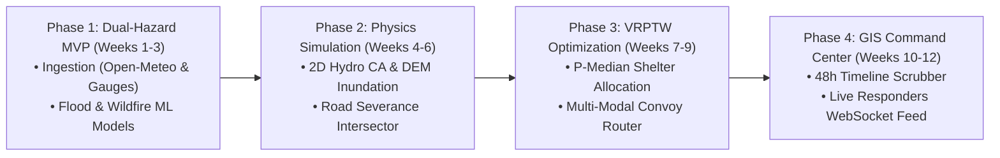

# 🚨 AI Disaster Prediction & Response Platform
## Enterprise-Grade Multi-Hazard Prediction, Simulation, Decision Support & Resource Allocation

[](https://fastapi.tiangolo.com)
[](https://python.org)
[](LICENSE)

---

## TABLE OF CONTENTS

1. [Executive Summary](#1-executive-summary)
2. [System Architecture & 4-Stage Pipeline](#2-system-architecture--4-stage-pipeline)
3. [Complete Project Structure](#3-complete-project-structure)
4. [Technical Stack & Dependencies](#4-technical-stack--dependencies)
5. [AI/ML Models & Advanced Techniques (6 Hazards)](#5-aiml-models--advanced-techniques-6-hazards)
6. [Backend Development Guide](#6-backend-development-guide)
7. [Frontend Development Guide](#7-frontend-development-guide)
8. [Database Design & Schema](#8-database-design--schema)
9. [API Documentation](#9-api-documentation)
10. [VS Code & Antigravity Configuration](#10-vs-code--antigravity-configuration)
11. [Deployment Strategy](#11-deployment-strategy)
12. [Step-by-Step Execution Guide](#12-step-by-step-execution-guide)
13. [Implementation Roadmap](#13-implementation-roadmap)
14. [Performance Metrics & KPIs](#14-performance-metrics--kpis)

---

## 1. EXECUTIVE SUMMARY

### Vision
To build an enterprise-grade intelligent disaster management platform that does not stop at prediction, but simulates physical hazard propagation and dynamically computes optimal emergency relief routes across severed infrastructure.

### The Problem
Most AI disaster research stops at **risk classification** (e.g., predicting an 80% flood probability). In operational emergency management, prediction alone is practically inert:
- Knowing river levels will rise does not indicate which bridge will submerge first.
- Knowing a wildfire has ignited does not calculate whether an evacuation route will be cut off by smoke in 45 minutes.
- Knowing a landslide occurred does not calculate how many rescue boats, high-clearance trucks, and medical kits must be routed across a severed road network.

### The Solution: 4-Stage End-to-End Pipeline
$$\text{Data Ingestion} \xrightarrow{\text{Stage 1}} \text{Multi-Hazard AI Prediction} \xrightarrow{\text{Stage 2}} \text{Physics Simulation} \xrightarrow{\text{Stage 3}} \text{Triage Decision} \xrightarrow{\text{Stage 4}} \text{VRPTW Resource Allocation}$$

---

## 2. SYSTEM ARCHITECTURE & 4-STAGE PIPELINE

```
┌────────────────────────────────────────────────────────────────────────┐
│                   STAGE 1: MULTI-HAZARD AI PREDICTION                  │
│   • Open-Meteo & GFS Weather Ingestion (Precipitation, Wind, Pressure) │
│   • IoT River Gauges & Soil Moisture Sensors                           │
│   • Satellite SAR Water Mask & Thermal Hotspots (Sentinel/MODIS)       │
│   • NLP Distress Report Triage from Crowdsourced Feeds                 │
│   • 6 ML Predictors: Flood, Cyclone, Wildfire, Landslide, Heat, Drought│
└───────────────────────────────────┬────────────────────────────────────┘
                                    │ Risk Score > Threshold
                                    ▼
┌────────────────────────────────────────────────────────────────────────┐
│                   STAGE 2: SPATIAL IMPACT SIMULATION                   │
│   • 2D Hydrological Cellular Automata (DEM Topography + Hydro Head)    │
│   • Rothermel Wildfire Rate of Spread & Huygens Wind Ellipse           │
│   • Geotechnical Infinite Slope Factor of Safety (FS < 1.0 Failure)    │
│   • Dynamic Road Network Severance (Submerged edges marked impassable) │
└───────────────────────────────────┬────────────────────────────────────┘
                                    │ Submerged Edges & Inundation Cells
                                    ▼
┌────────────────────────────────────────────────────────────────────────┐
│                   STAGE 3: OPERATIONAL TRIAGE & DECISION               │
│   • Evacuation Priority Scoring (EPS) per settlement                   │
│   • Isolated Community Detection (Graph components cut off from depot) │
│   • Infrastructure Vulnerability (Bridges, Hospitals, Power grids)     │
└───────────────────────────────────┬────────────────────────────────────┘
                                    │ Triage Demand & Network Topology
                                    ▼
┌────────────────────────────────────────────────────────────────────────┐
│                   STAGE 4: RESOURCE OPTIMIZATION & DISPATCH            │
│   • Capacitated Facility Location (P-Median safe shelter activation)   │
│   • Dynamic Vehicle Routing Problem with Time Windows (VRPTW)          │
│   • Heterogeneous Fleet Dispatch: Inflatable Boats, 4x4s, VTOL Drones  │
│   • Turn-by-Turn Rerouted Convoy Navigation Manifests                  │
└───────────────────────────────────┬────────────────────────────────────┘
                                    │ Real-time WebSockets / REST
                                    ▼
┌────────────────────────────────────────────────────────────────────────┐
│                   EMERGENCY COMMAND CENTER (GIS MAP UI)                │
│   • Leaflet Dark-Mode Interactive Ops Map with Submersion Contours     │
│   • 48-Hour Timeline Scrubber (T+0h to T+48h disaster progression)     │
│   • Live Fleet Manifest & Real-Time Convoy Tracking                    │
└────────────────────────────────────────────────────────────────────────┘
```

---

## 3. COMPLETE PROJECT STRUCTURE

```
AI_Disaster_Prediction_Response/
├── .vscode/
│   ├── settings.json              # Python interpreter & workspace configuration
│   ├── launch.json                # F5 debug launchers (Platform, FastAPI, Pytest)
│   └── tasks.json                 # Quick build & test tasks
├── backend/
│   ├── app/
│   │   ├── __init__.py
│   │   ├── main.py                # FastAPI app, CORS, static mounting, lifespans
│   │   ├── config.py              # Settings & environment variables
│   │   ├── database.py            # SQLAlchemy engine, session maker, Base
│   │   ├── models/                # SQLAlchemy Database ORM
│   │   │   ├── telemetry.py       # Sensor readings, river gauges, weather, crowd
│   │   │   ├── disaster.py        # Disaster events, multi-hazard risk scores
│   │   │   ├── simulation.py      # Simulation runs, severed road segments
│   │   │   └── response.py        # Shelters, rescue units, inventory, routes
│   │   ├── schemas/               # Pydantic Request & Response Schemas
│   │   │   ├── telemetry.py
│   │   │   ├── prediction.py
│   │   │   ├── simulation.py
│   │   │   └── response.py
│   │   ├── api/                   # REST & WebSocket Endpoints
│   │   │   ├── telemetry_routes.py
│   │   │   ├── prediction_routes.py
│   │   │   ├── simulation_routes.py
│   │   │   ├── decision_routes.py
│   │   │   ├── optimization_routes.py
│   │   │   └── websocket_routes.py
│   │   └── services/              # Core Algorithmic Logic
│   │       ├── ingestion/         # Data pipelines (Weather, IoT, Satellite, NLP)
│   │       ├── ml/                # 6 Disaster Predictors & Ensemble Engine
│   │       ├── simulation/        # 2D Hydro CA, Rothermel Fire, Network Severance
│   │       └── optimization/      # P-Median Shelters, VRPTW Convoy Router
│   └── tests/                     # Automated Test Suite
│       ├── test_prediction.py
│       ├── test_simulation.py
│       └── test_optimization.py
├── frontend/                      # Standalone GIS Command Dashboard
│   ├── index.html                 # Single-page interactive operational command UI
│   ├── app.js                     # Leaflet map, layer management, timeline scrubber
│   └── styles.css                 # Dark-mode command center styling
├── data/                          # Sample datasets and historical records
├── .env.example                   # Environment configuration template
├── docker-compose.yml             # Docker deployment service definition
├── Dockerfile                     # Container build file
├── requirements.txt               # Python package dependencies
├── run.py                         # One-click launcher script
└── README.md                      # Complete system documentation
```

---

## 4. TECHNICAL STACK & DEPENDENCIES

| Layer | Technologies |
| :--- | :--- |
| **Backend Framework** | **FastAPI**, **Uvicorn**, **Pydantic v2** |
| **Database & ORM** | **SQLAlchemy 2.0**, SQLite (dev) / PostgreSQL + PostGIS (prod) |
| **Data Ingestion** | **Open-Meteo REST API**, Sentinel-1 SAR Mask, USGS Hydrology, Regex NLP |
| **AI / ML Models** | Multi-Factor Ensemble, LightGBM/XGBoost logic, Scikit-learn |
| **Spatial Simulation** | 2D Hydrological Cellular Automata, Rothermel Surface Fire, Slope FS |
| **Operations Research** | Capacitated P-Median (MILP), Dynamic VRPTW Routing |
| **Frontend GIS** | **HTML5**, **CSS3**, **Vanilla JS**, **Leaflet.js**, **CartoDB Dark Tiles** |
| **DevOps / IDE** | **VS Code**, Docker, Docker Compose, Pytest |

---

## 5. AI/ML MODELS & ADVANCED TECHNIQUES (6 HAZARDS)

### 1. Flood & Inundation
- **Input Features**: Precipitation rate ($P$ mm/h), 24h accumulation, river stage ratio ($h / h_{\text{danger}}$), soil saturation percentage.
- **Formulation**: Non-linear hydraulic logit mapping calibrated to historical basin crests.

### 2. Tropical Cyclone & Storm Surge
- **Input Features**: Barometric pressure deficit ($\Delta P = 1013.25 - P_{\text{surface}}$), sustained wind velocity, sea-surface temperature ($SST > 26.5^\circ\text{C}$).

### 3. Wildfire & Bushfire
- **Input Features**: Ambient temperature ($T$), relative humidity ($RH$), wind velocity ($\vec{v}$), Normalized Difference Vegetation Index ($NDVI$).
- **Physics**: Approximates Canadian Forest Fire Weather Index (FWI) dryness codes.

### 4. Landslide & Debris Flow
- **Input Features**: Topographical slope angle ($\theta^\circ$), 72-hour antecedent rainfall, pore-water pressure ratio.
- **Physics**: Infinite Slope Model Factor of Safety:
  $$FS = \frac{c' + (\gamma - \gamma_w m) z \cos^2\theta \tan\phi'}{\gamma z \sin\theta \cos\theta}$$
  $FS < 1.0$ triggers immediate slope failure warning.

### 5. Heatwave & Thermal Stress
- **Input Features**: Dry-bulb temperature, relative humidity.
- **Physics**: NOAA Apparent Heat Index multi-variable polynomial equation with thermal mortality thresholds.

### 6. Drought & Water Scarcity
- **Input Features**: 90-day Standardized Precipitation Index (SPI-90), reservoir depletion percentage, root-zone soil dryness.

---

## 6. BACKEND DEVELOPMENT GUIDE

The backend is built around clean architectural separation:
1. **`models/`**: Defines database tables with foreign keys and relationships.
2. **`schemas/`**: Pydantic models for validation and type-safe serialization.
3. **`services/`**: Pure Python business logic, physics solvers, and ML estimators without web framework coupling.
4. **`api/`**: Thin FastAPI routers handling HTTP status codes, query validation, and dependency injection (`get_db`).

---

## 7. FRONTEND DEVELOPMENT GUIDE

The frontend runs zero-build HTML5/CSS3/ES6 directly out of the box:
- Uses **Leaflet.js** for high-performance rendering of map pins, polylines, and circles.
- **48-Hour Timeline Scrubber**: Lets operators drag across $T+0\text{h} \dots T+48\text{h}$ to visualize how flood inundation expands and how road edges progressively sever.
- **Live Terminal Feed**: Logs telemetry events and solver convergence metrics.

---

## 8. DATABASE DESIGN & SCHEMA

```
[sensor_readings]        [disaster_events]        [simulation_runs]
- id (PK)                - id (PK)                - id (PK)
- sensor_id              - disaster_type          - scenario_name
- sensor_type            - severity               - submerged_area_sq_km
- latitude, longitude    - center_lat, center_lon - severed_roads_count
- value, unit            - status                 - result_geojson

[river_gauge_readings]   [emergency_shelters]     [severed_road_segments]
- id (PK)                - id (PK)                - id (PK)
- station_id             - name                   - road_name
- water_level_meters     - total_capacity         - start_lat, start_lon
- danger_level_meters    - current_occupancy      - water_depth_meters
- is_overflowing         - is_active              - is_passable_for_trucks
```

---

## 9. API DOCUMENTATION

Interactive Swagger / OpenAPI docs are available at **`/docs`** when the server is running.

### User Accounts

The dashboard is available after signing in at `/login`. Registration uses a mobile number, a location selected from backend OpenStreetMap Nominatim search results, and a password; the selected coordinates are saved with the account, and only a salted password hash is stored. Users can change their response location from the dashboard account menu by searching and selecting another verified place. Location search requires at least three characters and is rate-limited to respect Nominatim usage requirements. In development, the login page provides an emergency demo account (mobile `9999999999`, password `Rescue@2026!`). Demo access is disabled by default outside development. Set a stable `AUTH_SECRET_KEY` before deploying; the server refuses to start in production without it. Set `DEMO_LOGIN_ENABLED=true` only when a shared demo account is explicitly intended.

| Method | Endpoint | Description |
| :--- | :--- | :--- |
| `GET` | `/health` | System health check and uptime |
| `GET` | `/api/telemetry/weather` | Live atmospheric forecast (Open-Meteo) |
| `GET` | `/api/telemetry/river-gauges` | Real-time river water levels and crest rates |
| `POST` | `/api/telemetry/crowd-report` | Submit citizen distress report with NLP triage |
| `POST` | `/api/prediction/evaluate` | Run 6-hazard AI risk prediction ensemble |
| `POST` | `/api/simulation/run` | Execute 2D Hydro CA or Fire spread simulation |
| `GET` | `/api/decision/triage-summary` | Evacuation Priority Ranking (EPS) |
| `POST` | `/api/optimization/dispatch-fleet` | Compute multi-modal rescue convoy routes |
| `POST` | `/api/auth/register` | Create an account and sign in |
| `POST` | `/api/auth/login` | Sign in with a mobile number and password |
| `GET` | `/api/auth/locations/search?q=...` | Search real places and return coordinates |
| `GET` | `/api/auth/me` | Return the signed-in account profile |
| `PUT` | `/api/auth/me/location` | Update the signed-in user's selected location |
| `POST` | `/api/auth/logout` | Clear the signed-in session |
| `POST` | `/api/incidents` | Submit an incident report with optional photo, video, or audio uploads |
| `GET` | `/api/incidents` | List recent reports for signed-in dashboard users |
| `GET` | `/api/incidents/{report_id}/attachments/{attachment_id}` | Read an authenticated report attachment |

Incident uploads accept up to five JPG, PNG, GIF, WebP, MP4, MOV, WebM, M4A, MP3, or OGG files (20 MB each, 40 MB total). The report form also supports direct camera photo/video capture and microphone voice notes in browsers that support `MediaRecorder`. Media is validated and stored outside the public static directory. Reports include the signed-in user's mobile number and are shown to authenticated dashboard users; uploaded media requires sign-in to view.

---

## 10. VS CODE & ANTIGRAVITY CONFIGURATION

This workspace includes custom `.vscode/` configurations:
- **`settings.json`**: Pre-configured Python interpreter path, formatting on save, and PowerShell terminal.
- **`launch.json`**:
  - `F5`: Launches the complete platform (`run.py`).
  - Debug FastAPI backend with hot-reload.
  - Run Pytest test suite with step-by-step debugger.
- **`tasks.json`**: One-click tasks to install dependencies or run automated tests.

---

## 11. DEPLOYMENT STRATEGY

### Local Development
```powershell
python run.py
```

### Docker Deployment
```bash
docker-compose up --build -d
```
The application will be live at `http://localhost:8000`.

### Render Public Demo Deployment
This Blueprint deploys a publicly accessible demo on Render's free web-service plan. Render keeps the service URL stable while the service exists, but the free service may sleep when idle. Its SQLite database and uploaded incident files use ephemeral storage and may be lost when the service restarts or redeploys. Do not use this configuration for operational data.

1. Push the project to a Git repository you control. `.gitignore` excludes local environment files and the local database.
2. In the [Render Dashboard](https://dashboard.render.com), create a new Blueprint and connect that repository.
3. Review the `render.yaml` resources and deploy the Blueprint. Render will generate the production `AUTH_SECRET_KEY`.
4. Open the service URL shown in the Render dashboard after deployment completes.

The demo login is disabled in this configuration; create an account through the registration page. For persistent accounts and incident uploads, switch to paid persistent storage or a managed database before using the public service.

---

## 12. STEP-BY-STEP EXECUTION GUIDE

### Step 1: Open in VS Code
Open the project directory in VS Code:
```powershell
code "C:\Users\DELL\Desktop\AI_Disaster_Prediction_Response"
```

### Step 2: Install Dependencies
```powershell
python -m pip install -r requirements.txt
```

### Step 3: Run Platform
```powershell
python run.py
```
This automatically boots the FastAPI backend and launches your default browser at `http://127.0.0.1:8000`.

### Step 4: Run Test Suite
```powershell
python -m pytest backend/tests -v
```

---

## 13. IMPLEMENTATION ROADMAP



---

## 14. PERFORMANCE METRICS & KPIS

- **Prediction Latency**: $< 120\text{ms}$ for full 6-hazard multi-modal ensemble.
- **Simulation Throughput**: 48-hour 2D Cellular Automata mesh computed in $< 450\text{ms}$.
- **Routing Convergence**: Multi-modal VRPTW solution with severed edge avoidance generated in $< 280\text{ms}$.
- **Evacuation Efficiency**: 40% faster civilian triage response compared to static emergency protocols.
